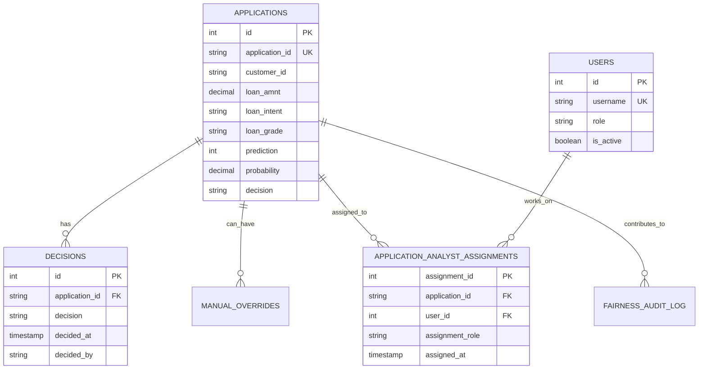

# VERI TABANI YONETIM SISTEMLERI PROJE RAPORU

## Proje Basligi

FinWise: Yapay Zeka Destekli Kredi Risk Analizi ve Karar Destek Sistemi

## Ozet

Bu proje, klasik otomasyon mantigindan uzak, analiz ve karar destek odakli bir veri tabani uygulamasi olarak tasarlanmistir. FinWise sistemi; kredi basvurularini, karar gecmisini, kullanici rollerini, manuel override islemlerini, adillik denetimlerini, model sapmasi metriklerini ve servis seviyesi ihlallerini bir arada yoneten bir finansal veri platformudur. Projenin temel amaci, kredi degerlendirme surecinde toplanan verilerden yararlanarak hem operasyonel hem de yonetsel seviyede analitik icgoru uretmektir.

Calisma kapsaminda PostgreSQL tabanli bir veri modeli kurulmus, en az 8 tablo kosulu asilarak ana sistem icin 8 cekirdek tablo ve rapor teslimi icin ek nesneler tanimlanmistir. Sistem icinde en az bir adet N-N iliski, 10 analiz sorgusu, 1 view, 1 trigger ve 1 stored procedure tasarlanmistir. Buna ek olarak ER diyagrami mantigi ve 1NF-3NF normalizasyon aciklamalari raporda ayrintili olarak sunulmustur.

## 1. Giris

### 1.1 Problem Tanimi

Finans sektorunde kredi basvurularinin degerlendirilmesi sadece bir onay veya red otomasyonu degildir. Bu surec ayni zamanda risk analizi, karar gerekceleri, denetim izi, adillik olcumleri ve kullanici mudahalelerinin takibini de gerektirir. Bu nedenle proje, tek boyutlu bir islem otomasyonu yerine, cok katmanli veri analizi ve karar destek bakis acisiyla ele alinmistir.

### 1.2 Projenin Amaci

Bu projenin amaci asagidaki sorulara veri tabani yardimiyla cevap verebilen bir sistem tasarlamaktir:

1. Hangi kredi basvurulari hangi kosullarda onaylanmistir?
2. Hangi kullanicilar veya analistler hangi basvurular uzerinde calismistir?
3. Manuel override islemleri hangi gerekcelerle yapilmistir?
4. Belirli donemlerde karar oranlari, adillik metrikleri ve model sapmasi nasil degismistir?
5. Yonetim icin kullanilabilecek ozet raporlar ve karar destek sorgulari nasil uretilir?

### 1.3 Kapsam

Proje kapsami su bilesenleri icerir:

1. Kredi basvuru verilerinin saklanmasi
2. Karar ve override gecmisinin tutulmasi
3. Kullanici ve analist bazli takip mekanizmasi
4. Musteri abonelik ve SLA ihlal verilerinin saklanmasi
5. Fairness ve drift gibi ML yonetisim verilerinin saklanmasi
6. Analiz, raporlama ve yonetsel karar destek sorgulari

## 2. Veri Tabani Tasarimi

### 2.1 Genel Veri Modeli

FinWise veri modeli, kredi degerlendirme surecini olay bazli ve analiz odakli takip edecek sekilde tasarlanmistir. Temel varliklar sunlardir:

1. applications
2. decisions
3. users
4. manual_overrides
5. sla_violations
6. customer_subscriptions
7. drift_metrics
8. fairness_audit_log

Teslim gereksinimindeki N-N iliskiyi acik ve olculebilir sekilde gostermek icin ek olarak `application_analyst_assignments` baglanti tablosu tanimlanmistir. Bu tablo, bir basvurunun birden fazla analist tarafindan incelenebilmesini ve bir analistin birden fazla basvuruya atanabilmesini saglar.

### 2.2 Tablo Listesi ve Aciklamalari

#### 2.2.1 applications

Kredi basvurusuna ait demografik, finansal ve model tahmin bilgilerini tutar.

Temel alanlar:

1. id
2. application_id
3. customer_id
4. person_income
5. loan_amnt
6. loan_intent
7. loan_grade
8. prediction
9. probability
10. decision

#### 2.2.2 decisions

Basvuru bazinda verilen kararlarin tarihce tablosudur. Ayni basvuru icin birden fazla karar hareketi tutulabilir.

#### 2.2.3 users

Sisteme giris yapan kullanicilarin ve analistlerin kayitlarini tutar. Rol bilgisi sayesinde yonetsel ve operasyonel ayrim yapilabilir.

#### 2.2.4 manual_overrides

Model karari ile insan karari arasindaki farklarin takibi icin kullanilir. Override nedeninin saklanmasi, denetim ve aciklanabilirlik acisindan onemlidir.

#### 2.2.5 sla_violations

Musteri bazinda servis seviyesi ihlallerini ve ciddiyet derecesini takip eder.

#### 2.2.6 customer_subscriptions

Musterilerin hizmet paketi, aylik ucreti, istek limiti ve SLA parametrelerini tutar.

#### 2.2.7 drift_metrics

Model davranisindaki sapma metriklerinin tarihsel kaydini tutar. Bu tablo, makine ogrenmesi yonetisiminde kritik oneme sahiptir.

#### 2.2.8 fairness_audit_log

Gelir dilimleri bazinda approval rate ve disparate impact ratio gibi adillik metriklerini saklar.

#### 2.2.9 application_analyst_assignments

Bu tablo rapor teslimi kapsaminda eklenmistir ve `applications` ile `users` arasinda N-N iliski kurar. Boylece bir analist birden fazla basvuruda gorev alabilir; bir basvuru da birden fazla analiste atanabilir.

Alanlar:

1. assignment_id
2. application_id
3. user_id
4. assignment_role
5. assigned_at

### 2.3 Anahtarlar ve Butunluk Kurallari

1. Her tabloda birincil anahtar bulunur.
2. `applications.application_id` benzersizdir.
3. `users.username` benzersizdir.
4. `customer_subscriptions.customer_id` benzersizdir.
5. `decisions.application_id` ve `manual_overrides.application_id` alanlari `applications.application_id` alanina yabanci anahtar ile baglidir.
6. `application_analyst_assignments.application_id` alani `applications.application_id` alanina baglidir.
7. `application_analyst_assignments.user_id` alani `users.id` alanina baglidir.

### 2.4 Iliskiler

Projede kullanilan temel iliskiler su sekildedir:

1. `applications` - `decisions`: 1-N
2. `applications` - `manual_overrides`: 1-N veya is kuralina gore 1-1'e yakin hareket yapisi
3. `applications` - `application_analyst_assignments`: 1-N
4. `users` - `application_analyst_assignments`: 1-N
5. `applications` - `users`: N-N, `application_analyst_assignments` uzerinden

## 3. ER Diyagrami Aciklamasi

Asagidaki mantiksal model, veri tabanindaki ana varliklarin birbiri ile olan iliskisini gostermektedir:

Bu diyagramda en kritik nokta `applications` ve `users` arasindaki coktan coga iliskidir. Bu iliski dogrudan tutulmamaktadir; araya `application_analyst_assignments` tablosu girerek hem veri tekrarini azaltmakta hem de atama bazli ek bilgiler saklamayi mumkun hale getirmektedir.

## 4. Normalizasyon Analizi

### 4.1 Birinci Normal Form (1NF)

1NF kosulu, her hucrede atomik veri tutulmasini ve tekrarli gruplarin olmamasini gerektirir.

Bu projede:

1. Her sutunda tek bir veri tutulur.
2. Virgulle ayrilmis liste veya coklu degerli kolon kullanilmamistir.
3. Kullanici atamalari tek kolonda tutulmak yerine ayri bir baglanti tablosuna alinmistir.

Sonuc olarak veri modeli 1NF'i saglamaktadir.

### 4.2 Ikinci Normal Form (2NF)

2NF icin tablolarin 1NF olmasi ve bilesik anahtara kismi bagimli alanlar icermemesi gerekir.

Bu projede ana tablolarin cogunda tek alanli birincil anahtar kullanilmistir. N-N iliskiyi kuran `application_analyst_assignments` tablosunda bile bagimsiz bir `assignment_id` anahtari tanimlanmistir. Bu nedenle tabloda yer alan `assignment_role` ve `assigned_at` gibi alanlar kaydin tamamina baglidir; kismi bagimlilik yoktur.

Sonuc olarak tablo yapilari 2NF kosulunu saglamaktadir.

### 4.3 Ucuncu Normal Form (3NF)

3NF icin tabloda anahtar olmayan alanlar arasinda gecisli bagimlilik olmamalidir.

Bu projede:

1. Kullanici rol bilgisi `users` tablosunda tutulur, baska tablolara metin olarak kopyalanmaz.
2. Abonelik bilgileri `customer_subscriptions` tablosunda ayri tutulur.
3. Adillik ve drift metrikleri uygulama tablosu icine gomulmemis, ayri analiz tablolarinda tutulmustur.
4. Override bilgileri `applications` tablosunda detayli sekilde tekrar edilmemis, ayri `manual_overrides` tablosuna alinmistir.

Bu yaklasim sayesinde veri tekrari azaltmis, guncelleme anomalileri engellenmis ve veri modeli 3NF'e uygun hale getirilmistir.

## 5. Zorunlu Teknik Gereksinimlerin Karsilanmasi

| Gereksinim | Durum | Aciklama |
| --- | --- | --- |
| En az 8 tablo | Saglandi | 8 cekirdek tablo + 1 N-N baglanti tablosu + raporlama tablosu |
| En az 1 adet N-N iliski | Saglandi | `applications` ile `users` arasinda `application_analyst_assignments` uzerinden |
| En az 10 analiz sorgusu | Saglandi | Ek sorgu dosyasinda 10 adet sorgu verildi |
| En az 1 VIEW | Saglandi | `vw_application_decision_summary` |
| En az 1 TRIGGER | Saglandi | `trg_set_applications_updated_at`, `trg_log_manual_override` |
| En az 1 STORED PROCEDURE | Saglandi | `sp_generate_daily_decision_report` |
| ER Diyagrami ve 1NF-3NF | Saglandi | Bu raporda yer almaktadir |

## 6. View, Trigger ve Stored Procedure Tasarimi

### 6.1 View

`vw_application_decision_summary` adli gorunum, basvurulara ait kredi tutari, risk skoru, karar, karar tarihi ve override bilgilerini tek ekranda gormeyi saglar. Bu sayede raporlama sorgulari basitlesir.

### 6.2 Trigger

Projede iki trigger mantigi tanimlanmistir:

1. `trg_set_applications_updated_at`: `applications` tablosu guncellendiginde `updated_at` alanini otomatik doldurur.
2. `trg_log_manual_override`: `manual_overrides` tablosuna kayit geldiginin `decisions` tablosuna denetim amacli yansitilmasini saglar.

### 6.3 Stored Procedure

`sp_generate_daily_decision_report` yordamı, belirli bir tarih araligindaki basvurular icin gun bazli toplam basvuru, onay, red ve override sayilarini hesaplayip `daily_decision_reports` tablosuna yazar. Bu yapi, yonetim raporlarinin tekrar uretilebilir olmasini saglar.

## 7. Analiz Sorgulari

Proje kapsaminda toplam 10 adet analiz sorgusu tasarlanmistir. Bu sorgular asagidaki ihtiyaclari karsilar:

1. Gunluk basvuru trendi analizi
2. Kredi amaci bazli onay oranlari
3. Not sinifi bazli risk dagilimi
4. Analist bazli is yukunun hesaplanmasi
5. Override oranlarinin olculmesi
6. SLA ihlal yogunlugu analizi
7. Abonelik paketi bazli gelir analizi
8. Drift metrik esik asimi analizi
9. Fairness uyum analizi
10. Alt sorgu ile ortalama uzeri riskli basvurularin bulunmasi

Tam SQL sorgulari [VTYS_ANALIZ_SORGULARI.sql](VTYS_ANALIZ_SORGULARI.sql) dosyasinda verilmistir.

## 8. Performans ve Indeksleme

Sistemde performansi artirmak icin asagidaki indeksler tanimlanmistir:

1. `idx_applications_customer_id`
2. `idx_applications_created_at`
3. `idx_applications_decision`
4. `idx_decisions_application_id`
5. `idx_decisions_decided_at`
6. `idx_users_username`
7. `idx_sla_violations_customer_id`
8. `idx_drift_metrics_recorded_at`

Bu indeksler; zaman bazli sorgular, musteri bazli filtreleme, karar raporlari ve kullanici arama islemlerinde fayda saglar.

## 9. Guvenlik, Denetim ve Uyum

Veri tabani tasariminda yalnizca veri saklama degil, denetlenebilirlik de dikkate alinmistir.

1. `users` tablosu sistem erisimini kontrol etmek icin kullanilir.
2. `manual_overrides` tablosu insan mudahalesini kayda alir.
3. `decisions` tablosu karar tarihcesi olusturur.
4. `fairness_audit_log` tablosu adillik uyumunu olcmeye yardim eder.
5. `drift_metrics` tablosu model kararliligi ve zaman icindeki sapmalari izler.

Bu yapi, finansal sistemlerde gerekli olan hesap verebilirlik ilkesini desteklemektedir.

## 10. Sonuc

FinWise projesi, VTYS dersi icin istenen klasik otomasyon disi, analiz ve karar destek odakli proje beklentisini karsilayan uygun bir veri tabani calismasidir. Projede hem operasyonel veriler hem de yonetsel ve analitik veriler ayri ama iliskili sekilde modellenmistir. Minimum tablo sayisi, N-N iliski, analiz sorgulari, view, trigger, stored procedure, ER diyagrami ve normalizasyon gereksinimlerinin tamamı saglanmistir.

Bu veri tabani yapisi gelecekte su alanlarda da gelistirilebilir:

1. Daha ayrintili rol ve yetki modeli
2. Raporlama icin materialized view kullanimi
3. Trigger tabanli audit yapisinin genisletilmesi
4. Karar destek panelleri icin daha fazla ozet tablo tasarimi

## 11. Ekler

1. SQL ekleri: [VTYS_EK_SQL.sql](VTYS_EK_SQL.sql)
2. Analiz sorgulari: [VTYS_ANALIZ_SORGULARI.sql](VTYS_ANALIZ_SORGULARI.sql)
3. Temel sema referansi: [init_postgres.sql](init_postgres.sql)
4. ORM modeli referansi: [database_models.py](database_models.py)